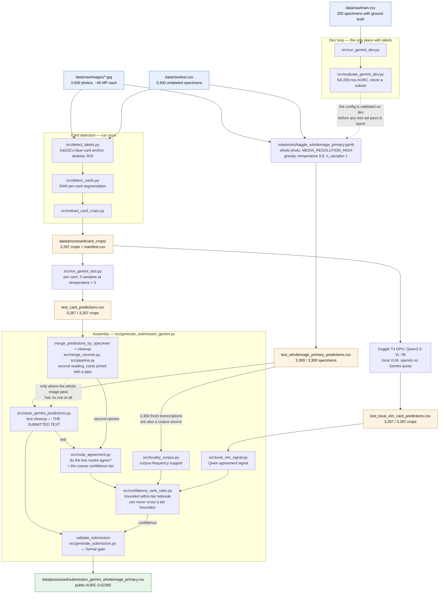

# museumscat-challenge

Kaggle competition: https://www.kaggle.com/competitions/museumscat-specimen-collection-annotation-task
(MuseumSCAT: Specimen Collection Annotation Task@CVNH ECCV26, hosted by the Natural History
Museum of Denmark)

Transcribes `verbatimDate` and `verbatimLocality` from photos of pinned Danish Dung Beetle
specimen labels, with calibrated per-field confidence, scored by **AURC over normalized edit
distance** — lower is better, and because AURC depends only on the *rank order* of the
confidences, a confidently wrong answer costs far more than an unsure one.

**Current approach:** a Gemini VLM pipeline whose transcribed text comes from the **whole
uncropped 45 MP photo**, with confidence built from *cross-route agreement* between that
reading and two independent second opinions. Best submitted result: **public AURC 0.02382**
(10th). `CLAUDE.md` has the full status, numbers and history.

## Pipeline

Text and confidence come from different places, which is the thing to understand before
reading the code: the whole-image route supplies **what the label says**, and the per-card
route plus a local VLM supply **how much to trust it**.



Two properties of that graph are load-bearing:

- **Only the whole-image route writes text.** The per-card route was the text source until
  2026-08-23; replacing it cut public AURC 0.04423 → 0.02530, the largest single gain since
  the classical→Gemini switch. It stays wired in because its disagreement with the whole-image
  reading is the most informative confidence signal available.
- **The greedy whole-image pass has no self-consistency**, so confidence could not come from
  sampling the same model. `src/route_agreement.py` exists to replace that missing signal.
- **A `MISSING` from the whole-image pass is kept as a real reading**, not overridden with
  per-card text. Doing the override is the partial-MISSING fallback design, and it regressed
  the real leaderboard twice. Per-card text is used only where the whole-image pass has no row
  at all — 0 specimens on the shipped submission.

Two modules in `src/` are deliberately *not* in that graph: `src/run_gemini_test_wholeimage.py`
(the both-MISSING fallback pass) and `src/confidence_penalty_rules.py` (the under-coverage
penalty) belong to the earlier submission variants below, not to the shipped route.

## Reproducing the submission

The transcription passes are the expensive part (~19 s per whole-image call, ~190 rows per hour
per API key, days of wall clock across two keys). Assembly from the already-collected CSVs is
seconds:

```bash
conda run -n museumscat-challenge python -m src.generate_submission_gemini \
    --wholeimage-primary-predictions-path \
        data/processed/gemini/test_wholeimage_primary_predictions.csv \
    --local-vlm-predictions-path \
        data/processed/gemini/test_local_vlm_card_predictions.csv
```

Earlier, lower-scoring variants are still reachable through the other flag combinations — one
isolated change each, so a leaderboard delta is attributable. See the module docstring of
`src/generate_submission_gemini.py`.

| submission | route | public AURC |
|---|---|---|
| `submission.csv` | classical OCR pipeline | 0.60501 |
| `submission_gemini.csv` | per-card Gemini + whole-image fallback | 0.06007 |
| `submission_gemini_rank_refined.csv` | + confidence rank refinement, text unchanged | 0.05073 |
| `submission_gemini_rank_refined_local_vlm.csv` | + local-VLM agreement, text unchanged | 0.04423 |
| `submission_gemini_wholeimage_primary.csv` | whole-image text + route agreement | 0.02530 |
| same file, risk-ordered route tiers | | **0.02382** |

`kaggle competitions submit` is deliberately never called from a script: 10 submissions/day,
2 final, and the competition ends 2026-08-31.

## Setup

```bash
conda env create -f environment.yml
conda run -n museumscat-challenge python src/download_kaggle_data.py  # data/, models/ are gitignored
```

Gemini pipeline runs need a free-tier `GEMINI_API_KEY` in the environment (Google AI Studio,
not Vertex AI). Free-tier *daily quota* — not billing — is the scarce resource, so analysis
work reuses already-collected raw samples instead of re-querying.

## Running tests

```bash
conda run -n museumscat-challenge python -m pytest
```

## Repo layout

- `src/` — **the active path only.** Every module here is reachable from
  `src/generate_submission_gemini.py` or one of the Gemini runners.
- `src/old/` — superseded stages and closed experiments: the classical OCR pipeline, the
  Danish recognizer fine-tune tooling, one-off EDA scripts, the manual annotation apps, and
  the confidence experiments that were measured and rejected. Nothing deleted, tests still
  run against it. See `src/old/README.md`.
- `notebooks/` — Kaggle kernels used as a second Gemini quota source and for the free T4 GPU.
- `tests/` — pytest, mirroring the `src/` module names.
- `data/`, `models/` — gitignored; 6.9 GB of images never go to GitHub.
- `docs/superpowers/plans/`, `docs/superpowers/specs/` — implementation plans and design docs
  in chronological order.
- `kaggle_meta/pages/` — competition rules and description, fetched verbatim.

## Docs

- `CLAUDE.md` — current status, environment, competition constraints, and the full
  chronological record of what was tried.
- **Four rounds ended in "measured, not adopted"** (the partial-MISSING fallback, the local-VLM
  blend, the ranking-constant sweep, and the arbitration pass). Their writeups were kept
  deliberately: the numbers are what stops a dead end being re-proposed.
